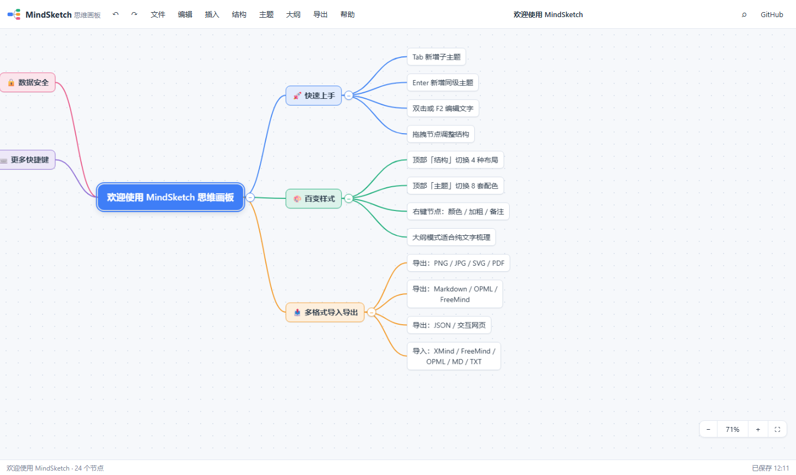

# MindSketch Mind Map Board

**Free, no sign-up, pure front-end online mind mapping.** All data stays in your own browser (localStorage) — nothing is uploaded to any server.

> Try it online: **https://lnotm.github.io/mindsketch/**
> 中文说明：[README.md](README.md)



## ✨ Features

### Editing (benchmarked against XMind)
- **4 layouts**: balanced mind map / logic chart right / logic chart left / org chart
- **8 themes** with rainbow branch coloring (links, nodes and collapse buttons share branch colors)
- **Full keyboard support**: `Tab` add child, `Enter` add sibling, `F2`/double-click edit, `Space` collapse, arrow-key navigation, `Ctrl+Z/Y` undo/redo, `Ctrl+C/X/V` clipboard, `Ctrl+B` bold, `Ctrl+F` search, `Ctrl+A` select all
- **Drag & drop restructuring**: drop on the middle of a node to make it a child, drop on top/bottom edge to insert before/after — with a live drop indicator
- **Rubber-band multi-select**: drag on empty canvas to lasso nodes; Ctrl+click toggles, Shift+click range-selects, Ctrl+A selects all
- **Multi-select batch ops**: delete / copy / cut / paste / drag whole groups (with ancestor-dedup so subtrees move together)
- **Drag ghost preview** and **auto-pan when dragging near canvas edges**
- **Node features**: notes (✎ badge), custom colors, bold, multi-line text, word wrap, collapse/expand
- **Snapshot undo/redo**: 120 steps; consecutive edits of the same node merge into one step

### Outline mode (inspired by Mubu)
- Two-way sync between canvas and indented outline; edit, add, remove and collapse right in the outline

### Import / Export (interoperability)
| Direction | Formats |
|------|------|
| Export | **PNG / JPG** (2–3× rasterized), **SVG** vector, **PDF** (single page, content-sized), **Markdown**, **OPML**, **FreeMind (.mm)**, **JSON**, **Interactive HTML** (single file with zoom/pan and branch collapsing) |
| Import | **XMind (.xmind**, both Zen `content.json` and legacy `content.xml`**)**, FreeMind, OPML, Markdown, indented TXT, JSON |

- Drag & drop files onto the page to import; pasting Markdown / indented text converts to subtrees automatically

### Documents & templates
- Multiple documents in local storage: create / rename / duplicate / delete / switch
- 4 quick-start templates: blank, weekly plan, reading notes, product launch checklist
- Autosave (700 ms debounce) + save on close; status bar shows last save time

### Canvas UX (inspired by Whimsical)
- Wheel / pinch zoom toward the cursor (10%–300%), rubber-band selection on empty canvas
- Pan: middle-button drag, Alt+drag, or touch drag; fit-to-canvas button; dot-grid background
- Works on touch devices (tap to select, double-tap to edit, pinch to zoom)

## 🆚 Design rationale vs. existing products

| Reference | What we adopted |
|----------|-----------------|
| XMind | Layouts, themes, branch coloring, shortcut system, collapse, rubber-band select, drag ghost & auto-pan |
| Mubu | Outline ⇄ map two-way editing |
| markmap | Markdown ecosystem + single-file interactive HTML export |
| GitMind | Zero-friction free usage; quick templates |
| Whimsical | Modern canvas feel: dot grid, cursor-centered zoom, animation & shadows |
| XMind / MindManager | Format interoperability: OPML / FreeMind / XMind import; export to image / document / data / web |

## 🚀 Run / Deploy

Static site — no build step, no backend:

```bash
# local preview (either)
python -m http.server 8137
npx serve .

# unit tests (Node, no browser needed)
npm test        # 52+ assertions: model ops, layout invariants, format roundtrips, security sanitize
```

Deploy to GitHub Pages: Settings → Pages → Source: `main` branch, root.

## 🧱 Implementation notes

- Vanilla HTML/CSS/JS, zero frameworks, zero build; CDN used only for two optional libraries (jsPDF, JSZip) with graceful degradation
- **Layout engine**: unified geometry for four structures with column/row alignment and subtree span collapsing
- **Dual rendering pipeline**: interactive view = DOM nodes + SVG links; export = the same layout data rendered as pure SVG, so exports match what you see
- PNG/JPG/PDF rasterized via SVG → Image → Canvas; PDF sized to content
- Security: node ids sanitized on import (whitelist), style colors restricted to `#hex`, CSP meta tag, all user text escaped through a single escaper
- Privacy: everything stays in `localStorage`; no network calls except two optional CDN libraries

## 📄 License

MIT License
