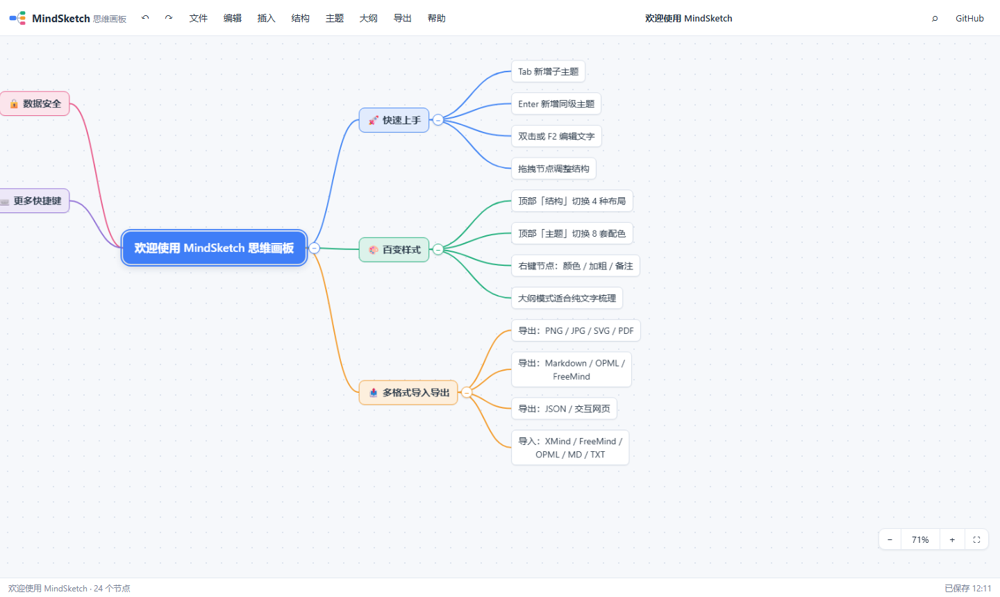

# MindSketch 思维画板

**免费、免注册、纯前端的在线思维导图工具。** 数据 100% 保存在你自己的浏览器本地，不上传任何服务器。

> 在线使用：**https://lnotm.github.io/mindsketch/**
> English: [README.en.md](README.en.md)



## ✨ 功能特性

### 编辑体验（对标 XMind）
- **4 种结构**：思维导图（左右平衡）/ 逻辑图·向右 / 逻辑图·向左 / 组织结构图
- **8 套主题**：经典蓝、森林绿、暖阳橙、紫罗兰、樱花粉、海洋青、极简黑白、夜幕深色
- **分支彩虹着色**：一级分支自动分配色板，连线/节点/折叠按钮同色（XMind 风格）
- **完整快捷键**：`Tab` 加子主题、`Enter` 加同级、`F2`/双击编辑、`Space` 折叠、方向键导航、`Ctrl+Z/Y` 撤销重做、`Ctrl+C/X/V` 复制剪切粘贴、`Ctrl+B` 加粗、`Ctrl+F` 搜索、`Ctrl+A` 全选
- **拖拽调结构**：拖到节点中部=变成子节点，拖到上/下边缘=插到前方/后方，带实时位置指示；拖起时显示**幽灵预览**（多选时显示 ×N 徽标），拖到画布边缘**自动平移**
- **框选多选（拖拽框）**：左键在空白处拖出**橡皮筋框选**多个节点；Ctrl+点击切换选中、Shift+点击范围选、Ctrl+A 全选；多选后可批量删除/复制/剪切/粘贴/**整体拖拽**（自动跳过集合内祖先，整树随迁）
- **关系线（v1.0.7 新增，借鉴 XMind）**：右键或「插入」菜单选「添加关系线」→ 点击目标节点即建立跨分支箭头连线；**双击连线**可添加文字标注；点击连线选中后 `Delete` 删除；删除端点节点时自动清理悬空关系线（可撤销）；SVG / 交互网页 / PNG / JPG / PDF 导出同步绘制
- **免打扰模式（v1.0.7 新增）**：`F9` 或 文件菜单一键隐藏工具栏/状态栏/缩放控件，纯画布沉浸编辑，再按 `F9` 退出
- **节点能力**：备注（✎ 角标）、自定义颜色、加粗、多行文本、自动换行、折叠/展开
- **快照式撤销/重做**：120 步历史，连续文字编辑自动合并为一步

### 大纲模式（借鉴幕布）
- 画布/大纲双视图实时同步，大纲里可直接增删改、折叠展开

### 导入 / 导出（格式互通）
| 方向 | 格式 |
|------|------|
| 导出 | **PNG / JPG**（2–3x 高清光栅化）、**SVG** 矢量、**PDF**（整图单页）、**Markdown**、**OPML**、**FreeMind (.mm)**、**JSON**、**交互网页 .html**（单文件、可缩放平移、分支可折叠） |
| 导入 | **XMind (.xmind**，支持 Zen content.json 与旧版 content.xml**)**、FreeMind、OPML、Markdown、缩进 TXT、JSON |

- 支持把文件直接**拖进页面**导入；粘贴外部 Markdown / 缩进文本会自动转换为子树
- Markdown 导入兼容标题层级与无序列表；导出支持 6 级标题 + 深层列表

### 多文档管理（借鉴 GitMind 模板思路）
- 浏览器本地多文档：新建 / 重命名 / 复制 / 删除 / 切换
- 4 个快速模板：空白导图、每周计划、读书笔记、产品发布
- 自动保存（防抖 700ms）+ 关页前强制保存，状态栏显示保存时间

### 画布交互（借鉴 Whimsical 的现代手感）
- **左键空白拖拽=框选多选**；中键/Alt+左键/触摸拖动=平移画布；滚轮/双指捏合以光标为中心缩放（10%–300%）；适应画布；点阵背景
- 移动端可用：触摸拖曳、双指缩放、双击编辑（桌面优先）

## 🆚 与市面产品的对比（设计依据）

| 借鉴对象 | 吸收的优点 | MindSketch 的取舍 |
|----------|-----------|------------------|
| XMind | 多结构、主题、分支着色、快捷键体系、折叠、框选多选、拖拽幽灵与边缘自动平移、关系线 | 结构/主题/快捷键/折叠/关系线全数吸收；不做的：概要、公式、自由节点位置（在 roadmap） |
| 幕布 | 大纲与导图一体 | 大纲面板双向同步 |
| markmap | Markdown 生态、交互 HTML | MD 导入导出 + 单文件交互 HTML 导出（可折叠） |
| GitMind | 免费无门槛、模板 | 完全免费无注册；内置 4 个实用模板 |
| Whimsical | 现代界面、流畅画布 | 点阵画布、光标缩放、框选、动画与阴影细节 |
| XMind/MindManager | 格式互通 | OPML / FreeMind / XMind 导入，导出覆盖图片/文档/数据/网页 |

## 🚀 本地运行 / 部署

纯静态站点，无构建步骤、无后端：

```bash
# 本地预览（任选其一）
python -m http.server 8137
npx serve .

# 单元测试（Node，无浏览器依赖）
npm test        # 52+ 项断言：模型 / 布局几何不变量 / 格式往返 / 导出完整性 / 安全净化
```

部署到 GitHub Pages：仓库设置 → Pages → Source 选 `main` 分支根目录即可。

## 🧱 技术实现

- 原生 HTML/CSS/JS，零框架、零构建；CDN 仅两处可选增强（jsPDF、JSZip，加载失败自动降级）
- **布局引擎**：四结构统一几何计算，列对齐 + 子树跨度收缩，保证兄弟子树零重叠
- **双渲染管线**：交互态用 DOM 节点 + SVG 连线；导出用同一布局数据生成纯 SVG（`<text>` 逐行排版，Canvas 测量与 DOM 渲染同字体栈，保证导出与所见一致）
- PNG/JPG/PDF 由 SVG → Image → Canvas 光栅化；PDF 用 jsPDF 按内容尺寸建页
- 隐私：所有数据仅存 `localStorage`，无任何网络上报

## 📁 目录结构

```
mindsketch/
├── index.html          # 入口页面
├── css/style.css       # 全部样式
├── js/
│   ├── util.js         # 工具：转义/测量/换行/颜色/下载
│   ├── model.js        # 数据模型（树操作/移动守卫/序列化）
│   ├── themes.js       # 8 套主题 + 节点尺寸测量/样式
│   ├── layout.js       # 布局引擎（map/right/left/org）
│   ├── io.js           # 导入导出（9 出 6 进）
│   ├── storage.js      # localStorage 多文档
│   ├── render.js       # 画布渲染 + 缩放平移
│   ├── editor.js       # 历史/快捷键/编辑/拖拽/菜单
│   ├── outline.js      # 大纲模式
│   └── app.js          # 工具栏/菜单/模态框/文档管理
└── tests/run.js        # Node 单元测试
```

## 📄 许可

MIT License
